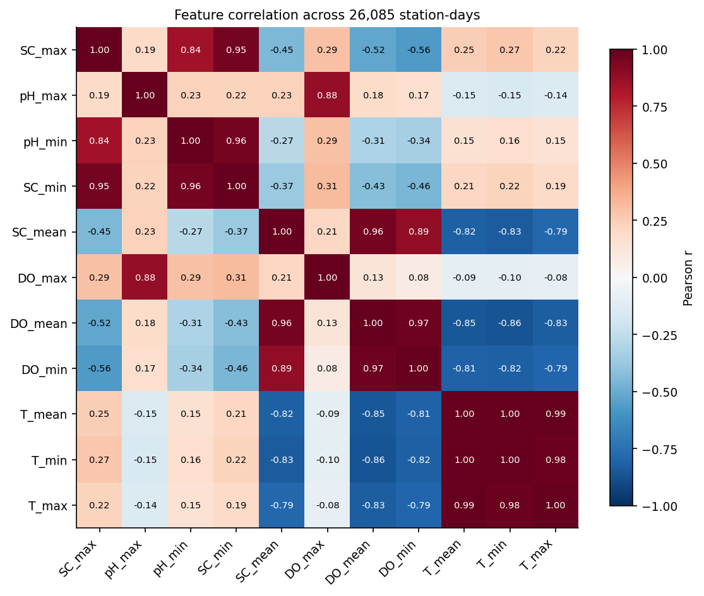
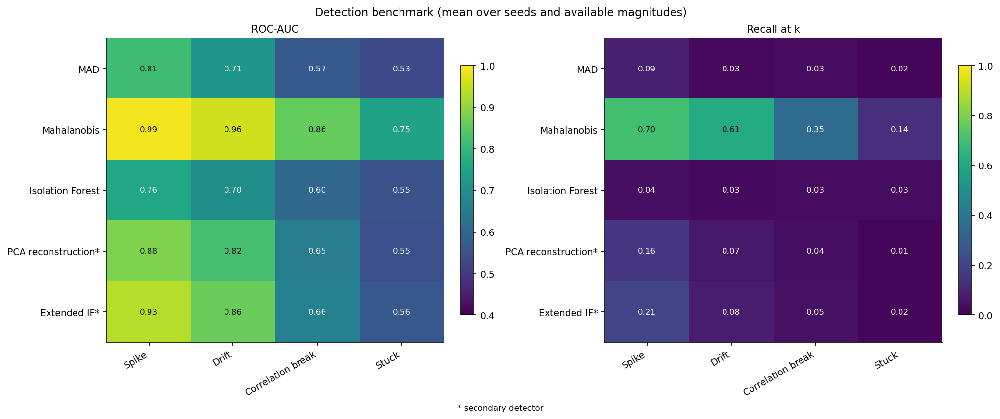
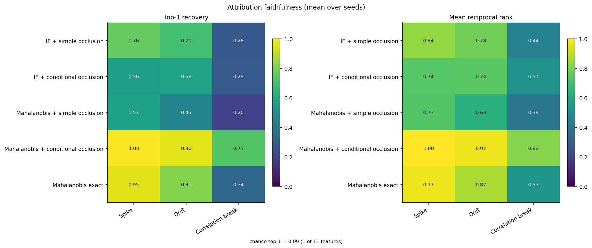
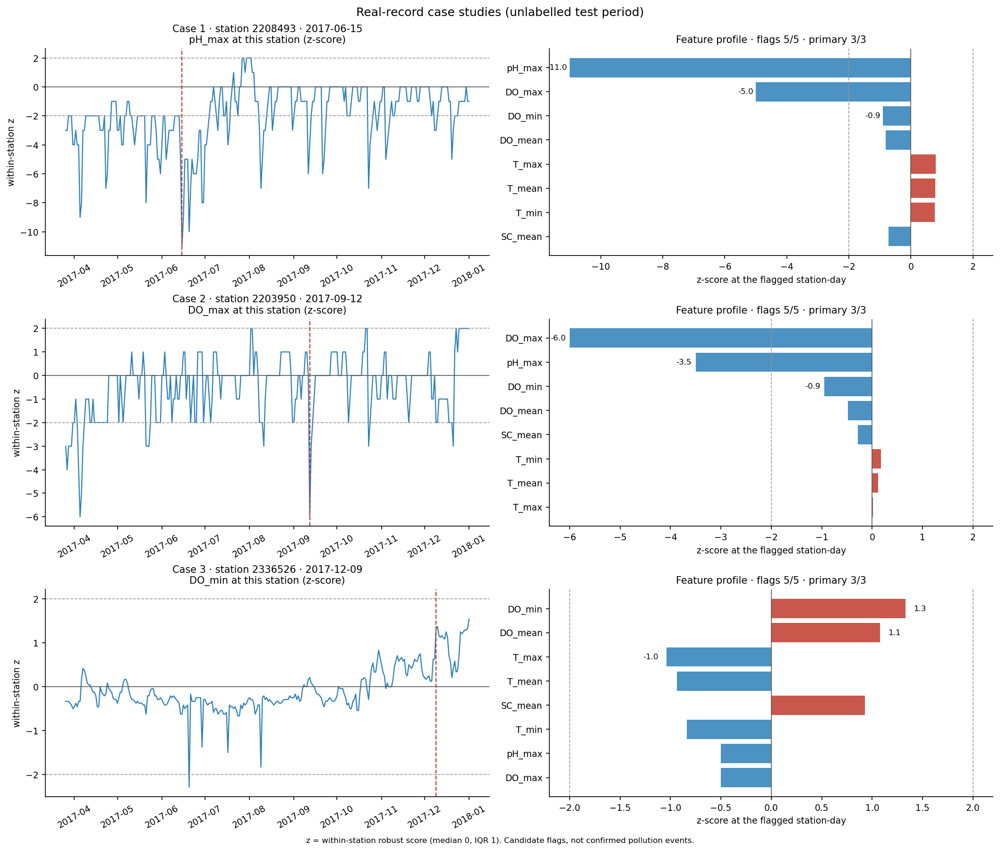

# Which Measurement Is Lying?

## Explainable Detection of Data-Quality Faults in Multi-Station Water-Quality Data

**Author:** Preetham
**Date:** November 2026
**Repository:** https://github.com/Pretz-glitch/ML_page
**Release:** v1.0

---

## Abstract

Water-quality monitoring networks produce multivariate station-day records in which an unusual observation may reflect a real environmental event or a data-quality fault in one measurement channel. Unsupervised detectors such as Isolation Forest are widely used to flag such observations, and post-hoc attribution methods are used to explain the flags. It is rarely checked whether those explanations identify the measurement actually responsible.

This project builds a controlled fault-injection benchmark on 26,085 station-days from 37 monitoring stations in Georgia, USA. Spike, drift and correlation-break faults are injected into the held-out test period with known labels, and five detectors — MAD, Mahalanobis distance, PCA reconstruction, Isolation Forest and Extended Isolation Forest — are compared. Local attribution is evaluated with simple occlusion, conditional occlusion and an exact Mahalanobis decomposition.

Three findings stand out. First, Mahalanobis distance is the strongest detector on every fault type (ROC-AUC 0.990 spike, 0.957 drift, 0.859 correlation break), while standard Isolation Forest is weaker than a univariate MAD baseline on spikes. Extended Isolation Forest closes much of the gap, implicating axis-parallel splits rather than the isolation principle. Second, explanation faithfulness depends heavily on the occlusion baseline: simple median occlusion makes Mahalanobis look poor (top-1 0.574 on spikes), while conditional occlusion raises it to 0.995. Third, on the unlabelled real record the detectors disagree substantially (pairwise Jaccard 0.123–0.620), and only 39 of 10,434 station-days are flagged by all three primary detectors.

The project does not claim that any flag is pollution, toxicity or a confirmed sensor failure. It provides a reproducible benchmark, an honest evaluation, and a detector/explainer selection guide.

---

## 1. Introduction

Water-quality monitoring is increasingly automated. Stations record dissolved oxygen, temperature, specific conductance and pH at daily or sub-daily resolution, and analysts must decide which observations deserve attention. An unusual observation can have two very different causes:

1. **An environmental event** — the water genuinely changed.
2. **A data-quality fault** — the sensor, channel or record is wrong.

Both look like outliers. Without labels, a detector that flags either is of limited use unless it can also say *which measurement* is responsible and *why*.

The default pipeline in the water-quality literature is to apply an unsupervised detector — most often Isolation Forest — to an unlabelled record, report the flags or a few case studies, and sometimes apply SHAP to explain them. Three things are usually missing:

- a comparison against a strong multivariate baseline;
- a fault taxonomy that separates spike, drift, dependence and stuck-sensor behaviour;
- a test of whether the explanation identifies the corrupted measurement.

This project addresses all three on one dataset, with a protocol that can be reused.

### Research questions

**RQ1 — Detection.** How accurately — measured by ROC-AUC, average precision and recall@k — do MAD, Isolation Forest and Mahalanobis distance detect injected spike, drift and correlation-break faults in the held-out test period of the UCI 733 multi-station water-quality record, and does the ranking depend on fault type?

**RQ2 — Explanation.** When a detector flags an injected fault, do local attribution methods identify the measurement that was actually corrupted, and how does attribution faithfulness differ between Isolation Forest and Mahalanobis?

A third, descriptive question concerns the unlabelled real record: what do the detectors flag, how much do they agree, and what do the flagged profiles look like?

### Contributions

1. A **fault-injection benchmark** for UCI 733 with known row, feature and fault-type labels.
2. A **detector comparison by fault type**, including a covariance baseline and a hyperplane isolation variant.
3. An **attribution-faithfulness audit** comparing simple occlusion, conditional occlusion and an exact Mahalanobis decomposition.
4. A **descriptive real-record analysis** with overlap, concentration and three case studies.
5. A **selection guide** for practitioners, with explicit limits.

---

## 2. Related Work

### 2.1 Anomaly detection in water-quality data

Water-quality anomaly detection is an established application area. Leigh et al. [7] proposed a feature-based framework for high-frequency in-situ sensor data. Santos-Fernández et al. [8] exploited spatial and temporal autocorrelation in stream networks. More recent work applies Isolation Forest to residual or flow-cytometry features [9, 10], or combines Isolation Forest with a supervised classifier [11]. Rigueira et al. [12] use multitemporal decision trees with visual decision paths.

Most of these studies share three properties: one detector, an unlabelled record, and an evaluation based on plausibility rather than ground truth. Deep learning approaches such as MCN-LSTM have also been applied [14]. Some studies apply SHAP, but the explanations are not tested against a known corrupted feature.

### 2.2 Explainable anomaly detection

The explainable anomaly-detection literature is more mature than its water-quality application. Li, Zhu and van Leeuwen [5] provide a taxonomy and note the lack of ground-truth evaluation. DIFFI [3] introduced depth-based feature importance for Isolation Forest. ExIFFI [4] extended this to Extended Isolation Forest and proposed an explanation-quality metric based on feature selection. Antwarg et al. [13] built a ground-truth framework for evaluating anomaly explanations in digital circuits.

The tools exist. The audit does not, in this application domain.

### 2.3 Isolation Forest and its limits

The original Isolation Forest [1, 2] partitions the feature space with cuts parallel to the axes. It is effective when anomalies are extreme in one or more coordinates, and weak when an observation is ordinary in every coordinate but violates the dependence structure between coordinates. Extended Isolation Forest [6] replaces axis-parallel cuts with random hyperplanes and improves detection of dependence anomalies.

That distinction matters here. The motivating example for multivariate water-quality anomaly detection — high temperature with high dissolved oxygen, or high conductance with low dissolved oxygen — is precisely a dependence anomaly.

### 2.4 Pitfalls

Hooker, Mentch and Zhou [15] show that permutation and ablation importance are unreliable when features are correlated. Nahari et al. [16] show that labelling anomalies by thresholding a variable that is also an input feature produces definitional label leakage. This project avoids the first by using local attribution and a correlation-aware occlusion baseline, and the second by generating labels through explicit perturbation rather than thresholds.

### 2.5 Gap

Prior work has applied Isolation Forest and post-hoc attribution to water-quality data. It has not tested whether the detector beats a strong multivariate baseline on a fault taxonomy, and it has not tested whether the explanation identifies the corrupted measurement. This project does both on one dataset and releases the benchmark.

---

## 3. Data

### 3.1 Dataset

The UCI *Water Quality Prediction* dataset (733) contains daily measurements from 37 monitoring stations in Georgia, USA, from 2016-01-28 to 2018-01-01 [17]. The distributed file stores 423 training days and 282 test days as MATLAB cell arrays; each day is a 37 × 11 matrix.

| Property | Value |
|---|---|
| Station-days | 26,085 (705 days × 37 stations) |
| Features | 11 concurrent measurements |
| Split | 423 train days / 282 test days |
| Missing values | 0 |
| Values | globally min–max normalised to approximately [0, 1] |
| Station groups | 1, 8 and 28 stations |

The 11 features form four families:

| Family | Columns |
|---|---|
| Specific conductance | `SC_max`, `SC_min`, `SC_mean` |
| pH | `pH_max`, `pH_min` |
| Dissolved oxygen | `DO_max`, `DO_mean`, `DO_min` |
| Temperature | `T_mean`, `T_min`, `T_max` |

The `Y` variables (median pH) are the original forecasting target and are never used.

### 3.2 Audit

The audit found no missing values and no constant station-feature cells, but a severe station effect:

| Feature | Between-station variance | Median within-station IQR |
|---|---:|---:|
| `pH_min` | **0.928** | 0.0008 |
| `SC_min` | **0.920** | 0.0005 |
| `SC_max` | **0.901** | 0.0005 |
| `DO_max` | 0.443 | 0.0244 |
| `DO_min` | 0.416 | 0.1890 |
| `DO_mean` | 0.356 | 0.1742 |
| `SC_mean` | 0.336 | 0.1513 |
| `pH_max` | 0.321 | 0.0385 |
| `T_min` | 0.107 | 0.3590 |
| `T_mean` | 0.083 | 0.3500 |
| `T_max` | 0.063 | 0.3256 |

Three features have more than 90% of their variance between stations. A pooled detector would largely learn station identity.

Correlations are extreme: `T_mean`–`T_min` 0.996, `T_mean`–`T_max` 0.995, `DO_mean`–`DO_min` 0.972, `SC_mean`–`DO_mean` 0.960, `pH_min`–`SC_min` 0.957. The 11 columns are roughly four latent dimensions.



*Figure 1. Pearson correlation across 26,085 station-days. Within-family correlations approach 1.0.*

These two facts drive the methodology: within-station scaling is mandatory, and attribution must be interpreted by family and with a correlation-aware baseline.

---

## 4. Methodology

### 4.1 Unit of analysis and split

The unit is a **station-day**. The tensor is flattened to 26,085 rows with `day_index`, `date`, `station_id`, `station_group`, `split` and 11 feature columns. The provided temporal boundary is respected: days 0–422 train, 423–704 test. No shuffling.

### 4.2 Within-station scaling

For each station `s` and feature `f`, using training days only:

```
z[t, s, f] = (x[t, s, f] - median_train[s, f]) / IQR_train[s, f]
```

This removes the between-station level and makes an anomaly mean “unusual for this station”. After scaling, training medians are 0 and IQRs are 1 for all 407 station-feature cells. Test rows are transformed with the training parameters only.

### 4.3 Fault injection

Faults are injected into the **raw** test values and then scaled. The injector returns a corrupted tensor, a tidy label table, a cell mask and a station-day mask.

| Fault | Definition | Real-world analogue |
|---|---|---|
| **Spike** | One station-day, one feature shifted by ±4–8 × training IQR | Electrical glitch, single bad reading |
| **Drift** | A 5–20 day linear ramp ending at ±4–8 × IQR | Calibration drift, biofouling |
| **Correlation break** | A 5–20 day window replaced by values of the same feature from other station-days | Channel swap, unit error, decoupled sensor |
| **Stuck** | A 5–20 day window held at its first value | Frozen sensor (diagnostic) |

Only features with meaningful within-station variation are eligible: `pH_max`, `SC_mean`, `DO_max`, `DO_mean`, `DO_min`, `T_mean`, `T_min`, `T_max`. The near-constant `SC_max`, `SC_min` and `pH_min` are excluded from injection.

The target prevalence is 2% of test station-days. The same injected rows are used across detectors within a seed, so comparisons are paired.

### 4.4 Detectors

All detectors are fitted on clean training data and score the corrupted test set. Higher scores mean more anomalous.

| Detector | What it models | Role |
|---|---|---|
| **MAD** | Maximum absolute within-station z-score | Univariate baseline |
| **Mahalanobis** | Mean and full covariance; sample covariance with pseudo-inverse | Covariance baseline |
| **PCA reconstruction** | Squared error after a three-component PCA | Linear-dependence baseline |
| **Isolation Forest** | Random axis-parallel cuts | Popular method under test |
| **Extended IF** | Random hyperplane cuts (`isotree`, `ndim = 11`) | Hyperplane isolation variant |

The Mahalanobis default is the sample covariance, not Ledoit–Wolf shrinkage. Shrinkage reduced spike AUC from 0.994 to 0.783 and correlation-break AUC from 0.863 to 0.482 on this data by shrinking the off-diagonal structure the benchmark depends on. Shrinkage remains available as a sensitivity variant.

### 4.5 Attribution methods

**Simple occlusion.** Replace feature `j` with the station's training median (`0` in the scaled space), re-score, and take the drop.

**Conditional occlusion.** Replace feature `j` with its Gaussian conditional mean `E[x_j | x_-j]`, using the mean and precision of a Mahalanobis reference fitted on training data. This keeps the row plausible under the correlation structure.

**Exact Mahalanobis contribution.** For a fitted Mahalanobis detector:

```
c_j = z_j * (Sigma^-1 z)_j,    sum_j c_j = d^2
```

The deletion test uses the **conditional** intervention for every method, so it is not confounded by implausible simple-occlusion rows. The reported statistic is the relative deletion advantage, `(drop_top - drop_random) / base_score`.

### 4.6 Metrics and protocol

Detection:

- ROC-AUC and average precision (AP) per fault type.
- Recall@k and precision@k at `k = number injected`.
- False-positive rate at the 99th percentile of clean training scores.

Attribution:

- Top-1 recovery, top-3 recovery, MRR and mean rank of the true feature.
- Relative deletion advantage.
- Majority top-1 agreement across five detector seeds.

Protocol:

- **Phase 3 (detection):** 5 seeds × (3 spike magnitudes + 3 drift magnitudes + 1 break + 1 stuck) × 5 detectors = 200 result rows. Magnitudes are 4, 6 and 8 × IQR.
- **Phase 4 (faithfulness):** 5 seeds × 3 faults × 11 attribution methods = 33 summary rows and 34,892 row-level records. Magnitude 6.
- **Uncertainty:** percentile bootstrap over the five seed-level estimates. Paired comparisons use a row-level paired bootstrap. With five seeds the detection intervals are coarse.

---

## 5. Results

### 5.1 Detection (RQ1)

**Mean ROC-AUC across five seeds**

| Detector | Spike | Drift | Correlation break | Stuck |
|---|---:|---:|---:|---:|
| MAD | 0.813 | 0.714 | 0.571 | 0.533 |
| **Mahalanobis** | **0.990** | **0.957** | **0.859** | **0.745** |
| Isolation Forest | 0.759 | 0.700 | 0.599 | 0.550 |
| PCA reconstruction | 0.884 | 0.823 | 0.654 | 0.546 |
| Extended IF | 0.934 | 0.864 | 0.665 | 0.565 |



*Figure 2. Mean ROC-AUC and recall@k by detector and fault type, averaged over seeds and available magnitudes.*

Three patterns are clear.

**Mahalanobis wins everywhere.** It leads on spike, drift, correlation break and the stuck diagnostic. The gap is largest on correlation breaks (0.859 vs 0.599 for standard IF), the fault type that motivates multivariate detection in the first place.

**Standard IF is weaker than MAD on spikes.** MAD reaches 0.813; IF reaches 0.759. On correlation breaks IF is only marginally above MAD (0.599 vs 0.571). The axis-parallel split is the likely reason: IF can isolate extreme coordinates, but not a point that is ordinary in every coordinate and wrong only in its dependence.

**Extended IF recovers much of the gap.** It reaches 0.934 on spikes and 0.665 on correlation breaks, well above standard IF. The isolation principle is not the problem; the split geometry is. On correlation breaks, however, even Extended IF remains well below Mahalanobis.

**Recall@k tells a harsher story**

| Detector | Spike | Drift | Correlation break | Stuck |
|---|---:|---:|---:|---:|
| MAD | 0.090 | 0.027 | 0.033 | 0.019 |
| Mahalanobis | **0.698** | **0.614** | **0.348** | **0.137** |
| Isolation Forest | 0.041 | 0.030 | 0.031 | 0.035 |
| PCA reconstruction | 0.159 | 0.065 | 0.036 | 0.014 |
| Extended IF | 0.211 | 0.078 | 0.046 | 0.018 |

At 2% prevalence, an AUC of 0.759 can coexist with a recall@k of 0.041. If an analyst can review as many rows as there are faults, standard IF finds about 4% of them on spikes. Mahalanobis finds about 70%. AUC ranks well; the review list does not.

The false-positive rate at the training 99th-percentile threshold is 1.74%–3.05% on test, rather than 1%, indicating mild score drift between the training and test periods.

### 5.2 Attribution faithfulness (RQ2)

**Top-1 recovery of the injected feature**

| Method | Spike | Drift | Correlation break |
|---|---:|---:|---:|
| IF + simple occlusion | 0.760 | 0.702 | 0.281 |
| IF + conditional occlusion | 0.558 | 0.579 | 0.292 |
| Mahalanobis + simple occlusion | 0.574 | 0.451 | 0.203 |
| **Mahalanobis + conditional occlusion** | **0.995** | **0.959** | **0.728** |
| Mahalanobis exact | 0.954 | 0.810 | 0.339 |
| MAD + simple occlusion* | 0.754 | 0.672 | 0.225 |
| MAD + conditional occlusion* | 0.469 | 0.409 | 0.147 |
| PCA + simple occlusion* | 0.796 | 0.734 | 0.290 |
| PCA + conditional occlusion* | 0.587 | 0.597 | 0.304 |
| EIF + simple occlusion* | 0.911 | 0.830 | 0.364 |
| EIF + conditional occlusion* | 0.836 | 0.792 | 0.311 |

\* secondary method



*Figure 3. Top-1 recovery and MRR for the five primary methods. Chance top-1 is approximately 0.09.*

Three findings matter.

**The occlusion baseline changes the conclusion.** Simple median occlusion makes Mahalanobis look poor: 0.574 on spikes, 0.451 on drift, 0.203 on correlation breaks. Conditional occlusion raises the same detector to 0.995, 0.959 and 0.728. The simple intervention replaces a feature with a value that is implausible given the other features, creating a row the model was never trained to score. That is an artefact of the explanation method, not a property of the detector.

**Detectors prefer different baselines.** IF is more faithful with simple occlusion on spikes and drift (0.760 / 0.702 vs 0.558 / 0.579); on correlation breaks the two are similar (0.281 vs 0.292). EIF is strong with both (0.911 / 0.830 / 0.364 and 0.836 / 0.792 / 0.311). The detector and the intervention interact.

**The exact Mahalanobis decomposition is strong but not the most faithful on breaks.** It reaches 0.954 / 0.810 / 0.339. Conditional occlusion beats it on every fault type, most strongly on correlation breaks (0.728 vs 0.339), because the additive decomposition spreads credit across correlated features.

**MRR for the headline methods:** Mahalanobis conditional 0.997 / 0.973 / 0.819; exact 0.974 / 0.873 / 0.527; IF simple 0.838 / 0.781 / 0.444.

**Stability (majority top-1 agreement across five detector seeds)**

| Method | Spike | Drift | Correlation break |
|---|---:|---:|---:|
| IF + simple | 0.916 | 0.886 | 0.780 |
| IF + conditional | 0.802 | 0.790 | 0.855 |
| Mahalanobis (all variants) | 1.000 | 1.000 | 1.000 |
| MAD / PCA (all variants) | 1.000 | 1.000 | 1.000 |
| EIF + simple | 1.000 | 0.997 | 0.979 |
| EIF + conditional | 0.997 | 0.993 | 0.991 |

Deterministic detectors are perfectly stable. IF is the least stable, with majority agreement as low as 0.780 on correlation breaks. Its explanations depend on the forest seed.

**Deletion.** The relative deletion advantage agrees with the ranking: 0.78 / 0.72 / 0.49 for Mahalanobis conditional, 0.76 / 0.66 / 0.34 for exact, and 0.10 / 0.09 / 0.04 for IF simple. The conditional intervention was used for every method, so the comparison is not confounded by implausible simple-occlusion rows.

### 5.3 Real-record analysis

The detectors were applied to the clean, unlabelled test period at the same training 99th-percentile threshold, averaged over five seeds.

| Detector | Flags | Rate |
|---|---:|---:|
| MAD | 214 | 2.05% |
| Mahalanobis | 294 | 2.82% |
| Isolation Forest | 182 | 1.74% |
| PCA reconstruction | 318 | 3.05% |
| Extended IF | 264 | 2.53% |

A total of **559 of 10,434 station-days (5.36%)** are flagged by at least one detector. Only **39** are flagged by all three primary detectors; **311** are flagged by at least two.

**Overlap.** Pairwise Jaccard ranges from **0.123** to **0.620**. The highest agreement is MAD–EIF (0.620), Mahalanobis–EIF (0.546) and Mahalanobis–PCA (0.515). The lowest is Mahalanobis–IF (0.123) and IF–PCA (0.126). IF agrees least with the covariance and reconstruction families.

**Concentration by station.** The most-flagged station (2203700) has 99 flags, 35.1% of its days. It is flagged 66 times by MAD, 96 by Mahalanobis, **0 by IF**, 99 by PCA and 84 by EIF — and never by all three primary detectors. A high flag count without consensus is a station-level disagreement, not a confirmed fault.

**Concentration by date.** The most-flagged date is 2018-01-01 with 19 flags, 18 of them from IF. The final test day may reflect a boundary or shared regime effect rather than 19 independent faults.

**Case studies**

| Case | Date | Station | Flags | Top feature | Top \|z\| |
|---|---|---|---|---:|---:|
| 1 | 2017-06-15 | 2208493 | 5/5 | `pH_max` | 11.00 |
| 2 | 2017-09-12 | 2203950 | 5/5 | `DO_max` | 6.00 |
| 3 | 2017-12-09 | 2336526 | 5/5 | `DO_min` | 1.33 |



*Figure 4. Three real-record cases. The left panel shows the station's history of the most extreme eligible feature; the right panel shows the full within-station z-profile at the flagged day.*

Case 1 is a large `pH_max` excursion with a concurrent `DO_max` drop. Case 2 is a large `DO_max` drop with a smaller `pH_max` deviation. Case 3 is the clearest **multivariate** flag: no eligible feature exceeds 1.33 IQR, yet all five detectors flag the combination. That is the pattern the project was designed to examine.

The case studies use the eight eligible features. The near-constant `SC_max`, `SC_min` and `pH_min` can produce unstable z-scores (310 and 86 in an early run) and are excluded from case selection and profile plots.

---

## 6. Discussion

### 6.1 The isolation model is not the best detector here

Standard Isolation Forest is widely used because it is fast, unsupervised and has few assumptions. On this benchmark it is not the strongest choice. It is weaker than a univariate MAD baseline on spikes, and only marginally above it on correlation breaks. Extended IF closes most of the detection gap, which locates the weakness in the axis-parallel split rather than in the isolation principle.

Mahalanobis is the strongest detector on every fault type. That does not make it universally better. It assumes a single Gaussian with a global covariance; multimodal, nonlinear or strongly non-Gaussian data could break it. Its advantage here is that the injected faults are exactly the kind of deviation a covariance model represents.

### 6.2 Explanations depend on the intervention

The most important methodological result is that attribution faithfulness is not a property of the detector alone. The same Mahalanobis detector looks unfaithful with simple median occlusion (0.574 on spikes) and highly faithful with conditional occlusion (0.995). The difference is the plausibility of the counterfactual row.

This matters for practice. A paper that reports “IF explanations are better than Mahalanobis explanations” based on simple occlusion would be reporting an artefact of the occlusion baseline. The baseline must be stated, justified and, where possible, compared.

The exact Mahalanobis decomposition is exact in the arithmetic sense — the contributions sum to the squared distance — but that does not make it the most faithful ranking. On correlation breaks, conditional occlusion identifies the corrupted feature far more often (0.728 vs 0.339), because the additive decomposition spreads credit across correlated features.

### 6.3 Low prevalence changes the practical picture

AUC is threshold-free and useful for ranking, but it can hide a poor review list. Standard IF reaches AUC 0.759 on spikes and recall@k 0.041. If the analyst can review as many rows as there are faults, IF surfaces about one in twenty-five. Mahalanobis surfaces about seven in ten.

Reports of anomaly detectors should include a prevalence-aware metric, not only AUC.

### 6.4 Real data: disagreement and station effects

On the unlabelled record the detectors disagree substantially. The pairwise Jaccard range is 0.123–0.620, and only 39 station-days are flagged by all three primary detectors. Station 2203700 is flagged by four detectors but never by IF, and never by consensus. The final test date is dominated by IF.

These patterns are not necessarily failures. They show that “the detector flagged it” is not a finding without a statement of which detector, which threshold and which cross-check. A conservative triage rule is to require agreement between at least two detector families before inspecting a station-day.

### 6.5 Practical recommendations

| Situation | Recommendation | Evidence |
|---|---|---|
| Detect spikes or drift | Mahalanobis | AUC 0.990 / 0.957 |
| Detect correlation breaks | Mahalanobis, but expect lower performance | AUC 0.859, top-1 0.728 |
| If an isolation model is required | Extended IF, not standard IF | AUC 0.934 / 0.864 / 0.665 |
| Explain Mahalanobis flags | Conditional occlusion or exact decomposition | top-1 0.995 / 0.959 / 0.728 |
| Explain IF flags | Simple occlusion | top-1 0.760 / 0.702 / 0.281 |
| Real-record triage | Require cross-detector corroboration | 39 consensus vs 559 any |

Single-feature retrain ablation should not be used as the primary explanation method here. In a pilot it changed the mean score by only 0.007–0.010 with rank correlation 0.96–0.985, and the importance ranking flipped under normalisation (Spearman 0.19 between raw-scale and per-station rankings).

---

## 7. Limitations

**No real anomaly labels.** The dataset contains no verified fault or pollution annotations. All detection and faithfulness numbers come from injected faults. They describe behaviour under this fault model, not field performance.

**Synthetic faults are an approximation.** Spike, drift, correlation break and stuck are motivated by sensor-data-quality literature, but real faults include dropouts, unit conversions, biofouling, communication gaps and multi-channel failures. A detector that performs well here may fail on a fault mode not represented.

**One magnitude in Phase 4.** Faithfulness uses magnitude 6 only. Detection improves with magnitude in Phase 3; attribution likely does too. The faithfulness results should not be read as magnitude-independent.

**Five seeds.** Detection intervals are bootstrap intervals over five seed-level estimates and are coarse. The paired comparisons in Phase 4 use row-level bootstrap and are tighter, but the rows are not independent across time.

**Gaussian conditional reference.** Conditional occlusion uses a single Gaussian fitted on training data. It is the natural intervention for Mahalanobis, but it is an external reference for IF, PCA and MAD.

**Normalised measurements.** All features are globally min–max normalised. There is no mapping back to physical units, so no drinking-water or regulatory threshold is applied.

**Single dataset and geography.** The data cover 37 stations in Georgia over 705 days. Conclusions may not transfer to other catchments, climates or sensor networks.

**Station confounding.** Within-station scaling reduces the station effect but does not eliminate it. A station with unusual within-station behaviour can still be flagged repeatedly.

**Near-constant features.** `SC_max`, `SC_min` and `pH_min` have tiny within-station IQRs and can produce unstable z-scores. They remain in the detector inputs; case studies and profile plots use the eight eligible features.

**No causal claims.** Feature contribution is not causation. A flagged station-day is a candidate for review, not a diagnosis.

---

## 8. Conclusion

This project asked whether explainable anomaly detectors identify the measurement actually responsible for a data-quality fault in multi-station water-quality data. The answer is conditional.

Detection: Mahalanobis distance is the strongest detector on every injected fault type. Standard Isolation Forest is weaker than a univariate MAD baseline on spikes and only marginally above it on correlation breaks. Extended Isolation Forest recovers much of the gap, implicating axis-parallel splits rather than the isolation principle.

Explanation: attribution faithfulness depends on both the detector and the occlusion baseline. Simple median occlusion makes Mahalanobis look poor because it creates implausible rows. Conditional occlusion raises Mahalanobis top-1 recovery to 0.995 on spikes, 0.959 on drift and 0.728 on correlation breaks. The exact additive decomposition is strong but not the most faithful on dependence faults.

Real data: the detectors disagree. Only 39 of 10,434 station-days are flagged by all three primary detectors, and one station accounts for 99 flags without ever reaching consensus. The three case studies show two single-feature excursions and one genuinely multivariate flag where no feature exceeds 1.33 IQR.

The practical message is not “use Mahalanobis”. It is: **state the detector, the threshold, the occlusion baseline and the cross-check; report prevalence-aware metrics; and treat every flag as a candidate for review, not a confirmed fault.**

---

## 9. Reproduction

```bash
python -m venv .venv
source .venv/bin/activate
pip install -r requirements.txt
./scripts/run_all.sh
```

The script runs the full pipeline, regenerates every table and figure, runs the release check and executes the 88 unit tests. The raw data are committed; the processed table is regenerated from the archive.

Key outputs:

- `results/phase1_summary.md` … `results/phase5_summary.md`
- `results/tables/` — audit, detection, faithfulness and real-record tables
- `results/figures/` — audit, detection, faithfulness and case-study figures
- `results/release_manifest.json` — checksums and row counts for the release
- `docs/report.md` and `docs/slides.md`

The raw archive is `data/raw/water_dataset.mat`, SHA-256 `228fd024d0c288247c5bbdf5eaa12404d69d0ec915003802c30908b3d2648ffd`.

---

## 10. References

1. Liu, F. T., Ting, K. M., & Zhou, Z.-H. (2008). Isolation Forest. *ICDM*. DOI: 10.1109/ICDM.2008.17
2. Liu, F. T., Ting, K. M., & Zhou, Z.-H. (2012). Isolation-based anomaly detection. *ACM TKDD*, 6(1). DOI: 10.1145/2133360.2133363
3. Carletti, M., Terzi, M., & Susto, G. A. (2023). Interpretable anomaly detection with DIFFI. *Engineering Applications of Artificial Intelligence*, 119. DOI: 10.1016/j.engappai.2022.105730
4. Arcudi, A., Frizzo, D., Masiero, C., & Susto, G. A. (2024). Enhancing interpretability and generalizability in extended isolation forests. *Engineering Applications of Artificial Intelligence*, 133. DOI: 10.1016/j.engappai.2024.109409
5. Li, Z., Zhu, Y., & van Leeuwen, M. (2023). A survey on explainable anomaly detection. *ACM TKDD*, 18(1). DOI: 10.1145/3609333
6. Hariri, S., Kind, M. C., & Brunner, R. J. (2019). Extended Isolation Forest. *IEEE TKDE*, 33(4). DOI: 10.1109/TKDE.2019.2947676
7. Leigh, C., et al. (2019). A framework for automated anomaly detection in high-frequency water-quality data from in situ sensors. *Science of the Total Environment*, 659. DOI: 10.1016/j.scitotenv.2019.02.085
8. Santos-Fernández, E., et al. (2024). Unsupervised anomaly detection in spatio-temporal stream network sensor data. *Water Resources Research*, 60. DOI: 10.1029/2023WR035707
9. Erb, I. K., et al. (2026). Beyond baselines for anomaly detection: Isolation Forest for baseline-free identification of anomalies in microbial water quality using explainable AI. *Water Research*. DOI: 10.1016/j.watres.2026.126825
10. Bhardwaj, J., & Cenkeramaddi, L. R. (2026). Unsupervised detection of multivariate water quality anomalies via residual feature embeddings. *IEEE Access*. DOI: 10.1109/ACCESS.2026.3704534
11. Fan, G. T., & Fan, D. K. (2026). Anomaly detection of water physicochemical indicators based on an Isolation Forest–Random Forest fusion algorithm. *Advanced Electromagnetics*, 15(3). DOI: 10.7716/aem.v15i3.4242
12. Rigueira, X., Olivieri, D. N., Araujo, M., & Pazo, M. (2026). An explainable AI model for anomaly detection in water quality data. *Water Resources Management*. DOI: 10.1007/s11269-026-04676-2
13. Antwarg, L., Galed, C., Rokach, L., & Shapira, B. (2024). Evaluating anomaly explanations using ground truth. *AI*, 5(4). DOI: 10.3390/ai5040117
14. El-Shafeiy, E., Alsabaan, M., Ibrahem, M. I., & Elwahsh, H. (2023). Real-time anomaly detection for water quality sensor monitoring based on multivariate deep learning technique. *Sensors*, 23(20). DOI: 10.3390/s23208613
15. Hooker, G., Mentch, L., & Zhou, S. (2021). Unrestricted permutation forces extrapolation: variable importance requires at least one more model. *Statistics and Computing*, 31. DOI: 10.1007/s11222-021-10057-z
16. Nahari, R. V., Prasetyo, T., & Alfita, R. (2026). Definitional label leakage in aquaculture water quality anomaly detection. *IJACSA*, 17(8). DOI: 10.14569/IJACSA.2026.0170873
17. Zhao, L., Gkountouna, O., & Pfoser, D. (2019). Spatial auto-regressive dependency interpretable learning based on spatial topological constraints. *ACM TSAS*, 5(3), Article 19. DOI: 10.1145/3339823
